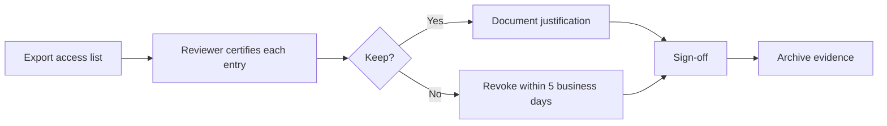

# Quarterly Access Review

**Quarter:** _ **Reviewer:** _ **Scope:** (department / application / privileged roles)

## Process

## Review table

| User | Access (group/role/app) | Last used | Still required? (Y/N) | Justification | Action |
|------|--------------------------|-----------|------------------------|---------------|--------|
|      |                          |           |                        |               |        |

## Focus areas

- Privileged roles and `PRIV-` groups
- Accounts with no sign-in for 90+ days
- Users who changed roles this quarter
- Guest accounts and service accounts

## Sign-off

Reviewer: _ Date: _ IAM verification: _ Date: _
