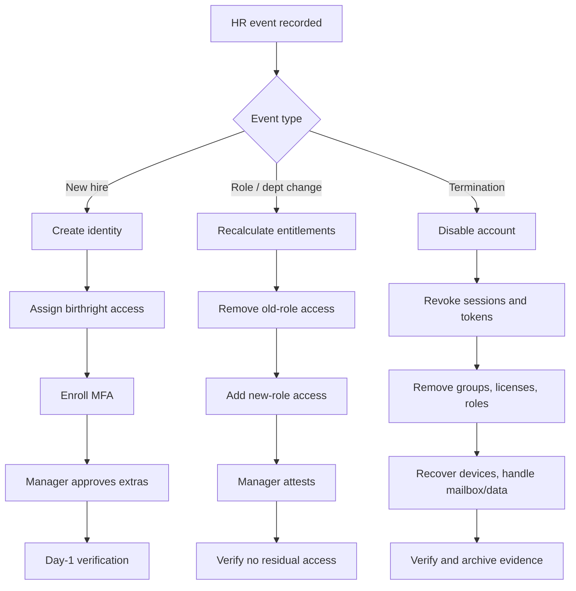

# Lifecycle Overview

Identity and access management governs who has access to what, from first day to last. The lifecycle has three stages, all driven by HR events.

## End-to-end flow

## Principles

1. **HR is the source of truth.** Identity actions follow HR records, never ad-hoc tickets.
2. **Least privilege by default.** Birthright access is the minimum for the role; everything else is requested and approved.
3. **Remove before add.** In a mover event, strip old access first.
4. **Time-bound.** Leaver disable happens on the termination effective time, not days later.
5. **Verify.** Every stage ends with a check that proves the intended state.
6. **Log everything.** Every action produces an audit record that detections can use.

## Roles and responsibilities

| Role | Responsibility |
|------|----------------|
| HR | Accurate, timely lifecycle events |
| Hiring manager | Approves non-birthright access, attests in reviews |
| IAM / IT | Executes and verifies provisioning |
| Security / SOC | Monitors for lifecycle anomalies |
| Application owners | Approve and certify app-specific access |
