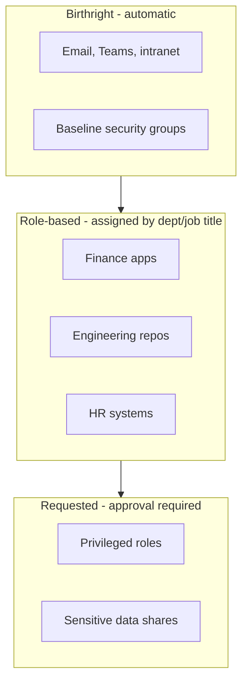

# Role Model (RBAC)

## Access tiers

## Naming convention

| Prefix | Meaning | Example |
|--------|---------|---------|
| `BR-` | Birthright group | `BR-AllEmployees` |
| `ROLE-` | Role/department group | `ROLE-Finance-Analyst` |
| `REQ-` | Approval-required access | `REQ-ProdDB-ReadOnly` |
| `PRIV-` | Privileged (PIM-eligible) | `PRIV-GlobalReader` |

## Role-to-access matrix (example)

| Department | Birthright | Role groups | Typical requested |
|------------|-----------|-------------|-------------------|
| Finance | `BR-AllEmployees` | `ROLE-Finance-Analyst` | `REQ-ERP-Approver` |
| Engineering | `BR-AllEmployees` | `ROLE-Eng-Developer` | `REQ-ProdDB-ReadOnly` |
| IT | `BR-AllEmployees` | `ROLE-IT-Support` | `PRIV-HelpdeskAdmin` |

## Design rules

- Assign access to **groups**, never directly to users.
- One `ROLE-` group per job family; avoid role explosion.
- Dynamic groups on `department`/`jobTitle` attributes keep mover handling automatic.
- Privileged access is **eligible, not permanent** (PIM).
