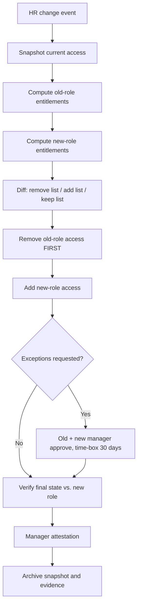

# Runbook: Role Change (Mover / Crossboarding)

**Trigger:** HR transfer, promotion, or department change.
**Owner:** IAM team with old and new managers. **SLA:** Within 1 business day of effective date.

The central risk is **privilege creep**: access accumulates because additions are made but removals are forgotten.

## Steps

| # | Step | Detail |
|---|------|--------|
| 1 | Snapshot | Export current groups, roles, app assignments (before-state) |
| 2 | Diff | Old role groups vs. new role groups |
| 3 | Remove | Remove old `ROLE-` and role-specific `REQ-` access |
| 4 | Add | Add new `ROLE-` groups, update `department`/`jobTitle`/`manager` |
| 5 | Exceptions | Any retained old access needs both managers' approval and an expiry |
| 6 | Privileged roles | Re-justify PIM eligibilities; default is remove |
| 7 | Verify | Final state matches new role only (plus approved exceptions) |
| 8 | Attest | New manager confirms access is appropriate |

## Detection tie-in

Run `detections/kql/mover-privilege-creep.kql` weekly to catch residual access.

## Exit criteria

- [ ] Before/after snapshots stored
- [ ] No old-role groups remain without approved, time-boxed exception
- [ ] Manager attestation recorded
