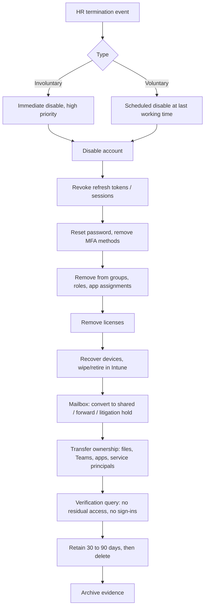

# Runbook: Offboarding (Leaver)

**Trigger:** HR termination or resignation record.
**Owner:** IAM team with HR, manager, and Service Desk.
**SLA:** Account disabled at the effective termination time. Involuntary exits: disable *before or during* the HR meeting.

## Steps

| # | Step | Detail |
|---|------|--------|
| 1 | Confirm event | Validate with HR; capture effective timestamp |
| 2 | Disable account | `accountEnabled = false` |
| 3 | Revoke sessions | Revoke refresh tokens; existing access tokens expire (up to ~1 hour) unless Continuous Access Evaluation applies |
| 4 | Reset credentials | Random password, remove MFA methods and registered devices |
| 5 | Remove access | Groups, directory roles, PIM eligibilities, app roles |
| 6 | Licenses | Remove after data-handling decisions are complete |
| 7 | Devices | Retrieve hardware, retire/wipe in Intune |
| 8 | Data | Convert mailbox to shared, set forwarding, apply holds if legal requires |
| 9 | Ownership | Reassign owned groups, apps, service principals, Power Platform assets |
| 10 | Verify | Run verification KQL, confirm zero sign-ins and zero memberships |
| 11 | Retain/delete | Soft-delete after retention window per policy |

## Detection tie-in

- `leaver-signin-after-disable.kql` alerts on any sign-in attempt after disable.
- `orphaned-accounts.kql` finds enabled accounts that should have been removed.

## Exit criteria

- [ ] Account disabled at effective time
- [ ] Zero group/role/app memberships
- [ ] Devices recovered
- [ ] No post-disable successful sign-ins
- [ ] Evidence archived
