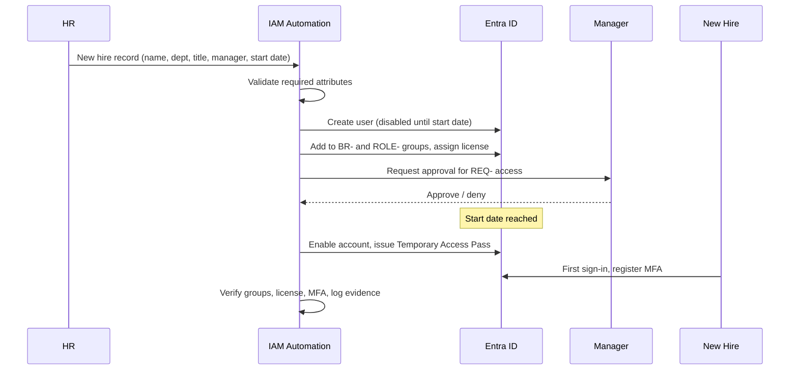

# Runbook: Onboarding (Joiner)

**Trigger:** New hire record in HR system, at least 3 business days before start date.
**Owner:** IAM team. **SLA:** Account ready by 08:00 on day 1.

## Steps

| # | Step | Detail | Evidence |
|---|------|--------|----------|
| 1 | Validate HR record | Required: legal name, dept, job title, manager, start date | HR ticket |
| 2 | Create identity | UPN per naming standard, `accountEnabled = false` until start date | Audit log entry |
| 3 | Set attributes | `department`, `jobTitle`, `manager`, `employeeId`, `employeeHireDate` | Graph output |
| 4 | Assign birthright | Add to `BR-` groups and `ROLE-` group for the job family | Group membership export |
| 5 | Assign license | Via group-based licensing where possible | License report |
| 6 | Request extras | Manager approves any `REQ-` access | Approval record |
| 7 | Enable on start date | Enable account, generate Temporary Access Pass | Audit log |
| 8 | MFA registration | User registers authenticator at first sign-in | Auth methods report |
| 9 | Day-1 verification | Confirm sign-in, MFA, groups, device compliance | Checklist |

## Exit criteria

- [ ] Account enabled, correct attributes
- [ ] MFA registered (no password-only access)
- [ ] Only birthright + approved access present
- [ ] Evidence stored
